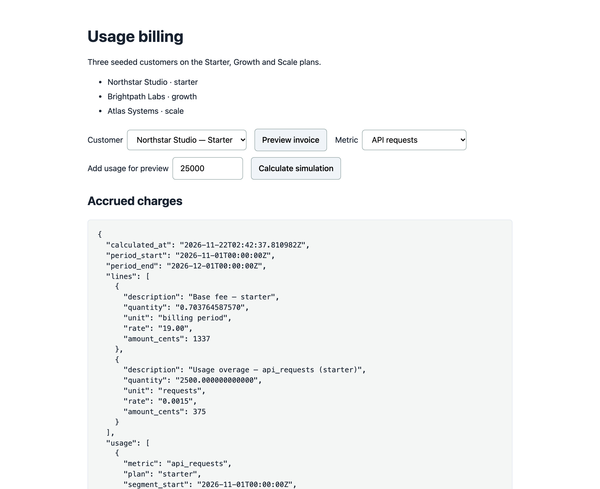
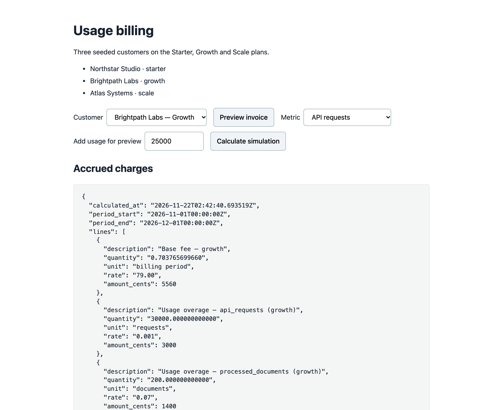
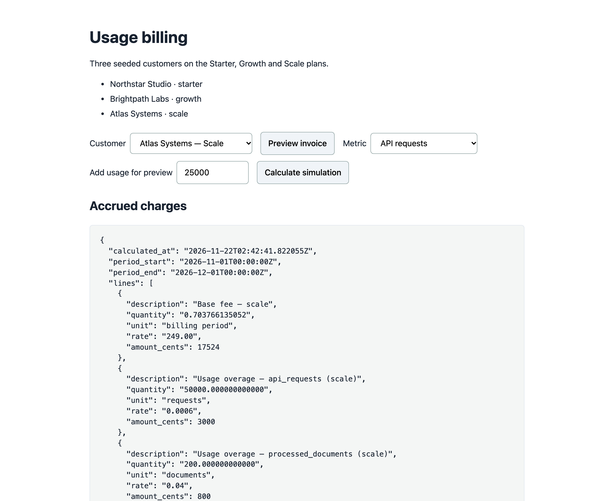
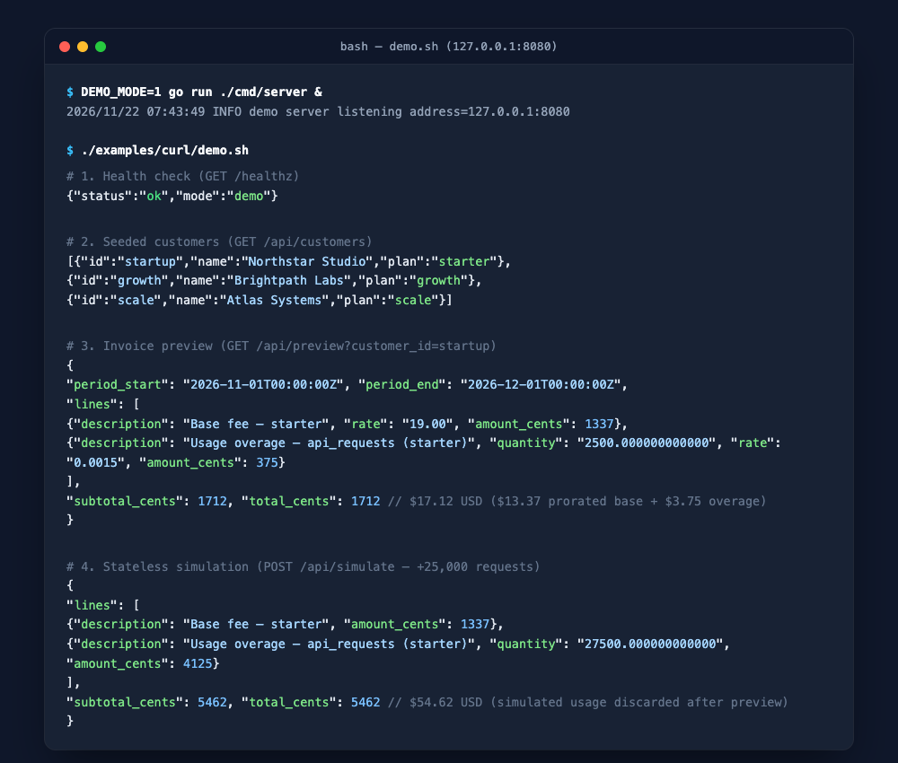
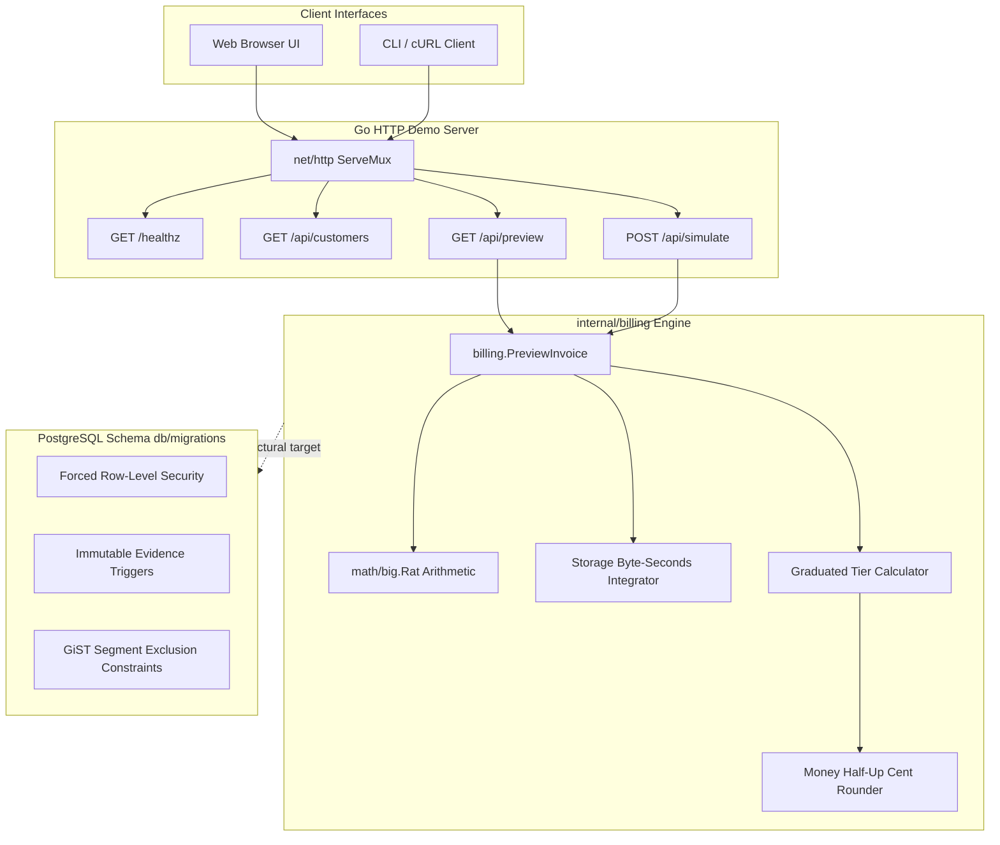

# usage-based-billing

Self-hosted usage metering and billing infrastructure for SaaS applications.

SaaS products need to measure usage, enforce plan allowances, calculate overages, and explain charges transparently. This project provides an exact-decimal Go billing calculation engine, a local web and REST demonstration server, and a tenant-aware PostgreSQL schema with row-level security and immutable audit triggers.


_Figure 1: Local demonstration interface showing an exact point-in-time invoice preview with prorated base fee, counter allowances, and overage calculations._

---

## The Problem It Solves

SaaS billing requires high mathematical precision and auditable evidence. Standard floating-point arithmetic introduces IEEE-754 rounding drift that is unacceptable in financial systems. Additionally, subscription plan changes occur mid-cycle, usage arrives continuously across different metrics (API requests, processed documents, storage byte-seconds), and invoices require deterministic, explainable calculations.

`usage-based-billing` addresses these challenges by providing:

1. **Exact rational arithmetic:** All money and unit rates enter as decimal strings, evaluate via `math/big.Rat`, and round half-up to integer cents only when final line items materialize.
2. **Deterministic boundary semantics:** Standard UTC calendar-month intervals with half-open bounds `[start, end)` ensure events on period boundaries are never double-counted or omitted.
3. **Mid-cycle segment proration:** Subscription segments split allowances and base fees strictly according to elapsed seconds.
4. **Time-weighted storage metering:** Gauge metrics integrate storage balances across time into decimal GB-months against historical plan segment rates.
5. **Interactive demonstration:** A loopback-only demo server that exercises invoice previews and stateless counter simulations without external dependencies.
6. **Hardened database foundation:** PostgreSQL schema with forced row-level security (RLS) policies, GiST exclusion constraints, and triggers prohibiting mutations to immutable billing evidence.

---

## Showcase & Demonstration Gallery

| Demonstration                                                                            | Description                                                                                                                                             |
| :--------------------------------------------------------------------------------------- | :------------------------------------------------------------------------------------------------------------------------------------------------------ |
| **Interactive Dashboard**<br>                | Web demonstration loaded with seeded customer tiers (**Starter**, **Growth**, and **Scale**), displaying active allowances and accrued charges.         |
| **Stateless Simulation**<br>               | Real-time counter simulation adding 25,000 API requests to Northstar Studio, immediately recalculating graduated overages without database persistence. |
| **Multi-Metric Growth Plan**<br> | Invoice preview for Brightpath Labs demonstrating simultaneous counter overages across both API requests and processed document volume.                 |
| **Scale Tier Calculation**<br>     | High-volume invoice preview for Atlas Systems illustrating enterprise base fee proration and graduated unit rates ($0.0006/request).                    |
| **CLI & REST API**<br>                         | Executing `examples/curl/demo.sh` against the loopback daemon, demonstrating `/healthz`, `/api/customers`, `/api/preview`, and `/api/simulate`.         |

---

## Key Features

- **Exact-Decimal Engine:** Zero floating-point math; rational intermediate fractions with Banker's / Half-Up cent rounding.
- **Half-Open Billing Periods:** Canonical UTC calendar months `[start, end)`; boundary events at `end` cleanly map to the subsequent period.
- **Segment-Specific Allowances:** Prorated included allowances per plan segment with graduated overage pricing tiers.
- **Continuous Storage Integration:** Gauge balance history integrated across elapsed seconds to calculate exact decimal GB-months (`1,000,000,000` bytes = 1 GB).
- **Stateless Counter Simulations:** Recompute previews with added volume on the fly without state mutations.
- **PostgreSQL Schema:** Row-Level Security (RLS) enforcement per tenant (`app.organization_id`), composite foreign keys, GiST interval exclusion constraints, and immutable-evidence triggers.
- **Self-Contained Local Demo:** Zero-dependency Go HTTP daemon and web interface for rapid local exploration.

---

## Quick Start

### Prerequisites

- [Go](https://go.dev/) 1.27 or newer
- Standard shell utilities (`curl`, `make`)

_Note: The local demonstration server does not require PostgreSQL._

### 1. Run Tests

Verify calculation semantics, rounding rules, and demo handlers:

```sh
go test ./...
```

Run with the race detector:

```sh
go test -race ./...
```

### 2. Launch the Demo Server

The demonstration server binds strictly to loopback (`127.0.0.1:8080`) and requires explicit activation via `DEMO_MODE=1`:

```sh
make run
# or: DEMO_MODE=1 go run ./cmd/server
```

### 3. Open the Web Interface

Open your browser to:

```text
http://127.0.0.1:8080
```

- Select a customer (**Northstar Studio**, **Brightpath Labs**, or **Atlas Systems**).
- Review the current-period accrued charges.
- Enter usage into the simulation input (e.g., `25000` API requests) and click **Calculate simulation** to see immediate recalculation.

---

## REST API & CLI Examples

The demonstration server provides four endpoints documented in [docs/openapi.yaml](docs/openapi.yaml):

| Endpoint         | Method | Description                                                                      |
| :--------------- | :----- | :------------------------------------------------------------------------------- |
| `/healthz`       | `GET`  | Health check (`{"status":"ok","mode":"demo"}`)                                   |
| `/api/customers` | `GET`  | Lists the three seeded customer profiles                                         |
| `/api/preview`   | `GET`  | Computes a point-in-time invoice preview (`?customer_id=startup\|growth\|scale`) |
| `/api/simulate`  | `POST` | Computes an invoice preview with simulated counter usage added                   |

### Automated Script

Run the included verification script:

```sh
./examples/curl/demo.sh
```

### Manual curl Examples

**List seeded customers:**

```sh
curl -s http://127.0.0.1:8080/api/customers
```

**Fetch invoice preview for Starter customer:**

```sh
curl -s "http://127.0.0.1:8080/api/preview?customer_id=startup"
```

**Simulate usage (add 25,000 API requests):**

```sh
curl -s -X POST http://127.0.0.1:8080/api/simulate \
  -H "Content-Type: application/json" \
  -d '{"customer_id":"startup","metric":"api_requests","quantity":25000}'
```

---

## Go Library Integration

Use `internal/billing` directly in Go applications for deterministic billing calculations:

```go
package main

import (
	"fmt"
	"time"

	"github.com/ranajahanzaib/usage-based-billing/internal/billing"
)

func main() {
	now := time.Now().UTC()
	start, end := billing.MonthBounds(now)

	plan := billing.Plan{
		Key:         "starter",
		MonthlyBase: "19.00",
		Prices: map[string]billing.MetricPrice{
			"api_requests": {
				Included: "10000",
				Unit:     "requests",
				Tiers:    []billing.Tier{{PricePerUnit: "0.0015"}},
			},
		},
	}

	segments := []billing.Segment{
		{Plan: plan, Start: start, End: end},
	}

	events := []billing.Event{
		{Metric: "api_requests", Quantity: 12500, At: now.Add(-time.Hour)},
	}

	preview, err := billing.PreviewInvoice(segments, events, nil, start, end, now)
	if err != nil {
		panic(err)
	}

	fmt.Printf("Subtotal: $%s\n", preview.Subtotal.String())
	for _, line := range preview.Lines {
		fmt.Printf("- %s: %s %s @ $%s = $%s\n",
			line.Description, line.Quantity, line.Unit, line.Rate, line.Amount.String())
	}
}
```

See [docs/integration-guide.md](docs/integration-guide.md) for patterns covering idempotency, reservation tokens, and two-phase admission.

---

## Architecture & System Design



See [docs/architecture.md](docs/architecture.md) for detailed transaction boundaries and schema semantics.

---

## Billing Semantics & Rules

Refer to [docs/billing-semantics.md](docs/billing-semantics.md) for formal policies:

- **Calendar Month Interval:** UTC `[start, end)`.
- **Base Fee Accrual:** $\text{Base Fee} \times \frac{\Delta t_{\text{elapsed}}}{\Delta t_{\text{period}}}$.
- **Floored Counter Allowances:** Segment allowances are calculated using integer division (`Num / Denom`) to prevent granting fractional included units.
- **Graduated Overage Tiers:** Each consecutive tier covers usage from boundary $N$ up to next boundary $M$.
- **Storage Byte-Seconds:** Integral of gauge bytes over time divided by $(\text{period seconds} \times 10^9 \text{ bytes/GB})$.
- **Monetary Rounding:** Exact rational amounts round half-up (`ROUND_HALF_UP`) to integer cents on materialization.

---

## Development

```sh
# Format source files
make fmt

# Run unit and handler tests
make test

# Run tests with race detection
go test -race ./...

# Run static analysis
make vet

# Compile binary
make build
```

---

## Project Status & Limitations

This repository delivers an exact-decimal billing calculation library, schema design, and demonstration application. It is **not** a turnkey production billing SaaS service.

Key boundaries (see [docs/limitations.md](docs/limitations.md) and [docs/security.md](docs/security.md)):

- The demo server does not connect to PostgreSQL or provide authentication; it runs in loopback demo mode.
- External payment gateway processing (e.g. Stripe checkout) is outside project scope.
- Hard-quota enforcement, late-event reconciliation, and invoice finalization workflows require integration into your host application architecture.

---

## Contributing

Contributions are welcome. Please read [CONTRIBUTING.md](CONTRIBUTING.md) and our [Code of Conduct](CODE_OF_CONDUCT.md). For security reports, follow the policy in [.github/SECURITY.md](.github/SECURITY.md).

---


## License & Custom Work

[](mailto:work@withrana.com) [](https://www.linkedin.com/in/workwithrana)
[](https://www.upwork.com/freelancers/~01bbcf6edb91a8df5f)
[](https://contra.com/ranajahanzaib/)

**License:** MIT, see [LICENSE](LICENSE). Free for personal and commercial use.

**Author:** Rana Jahanzaib

**Need this built for your stack?** Email me what you're working on: work@withrana.com
